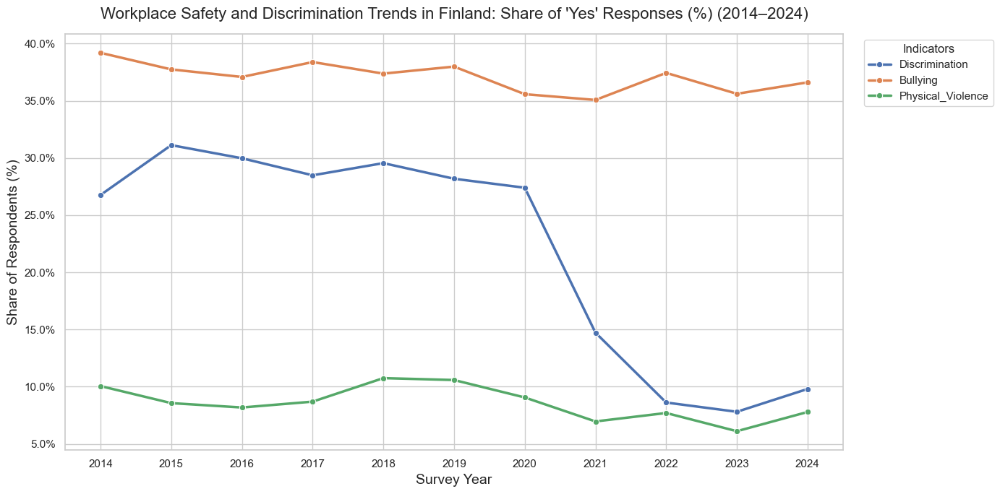
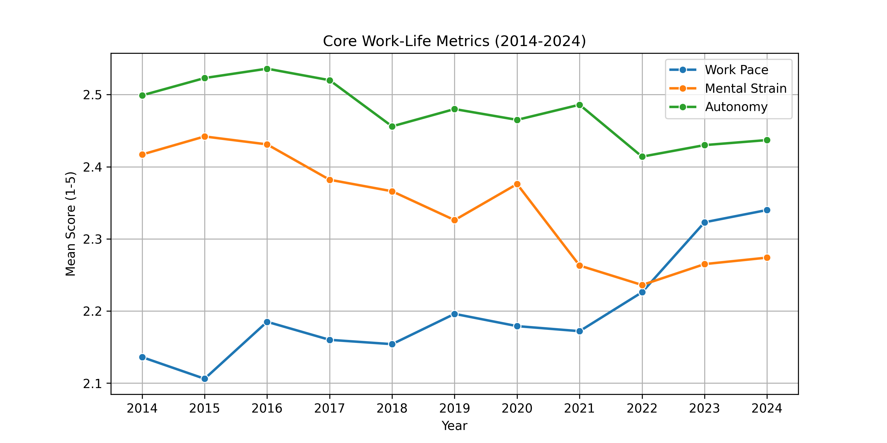
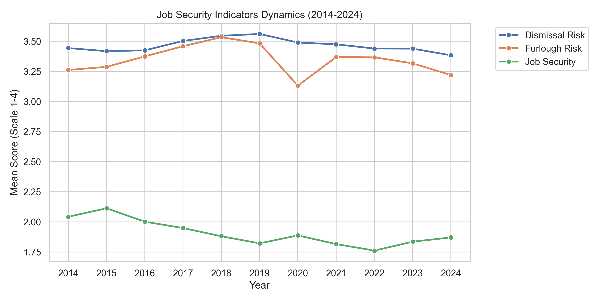
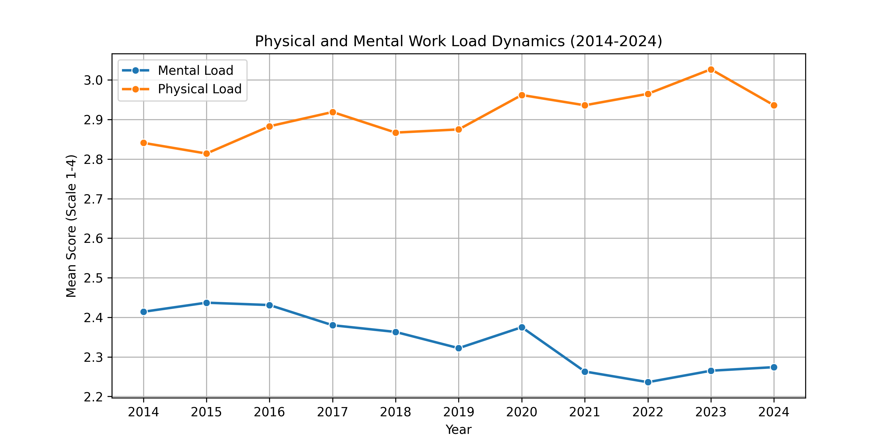
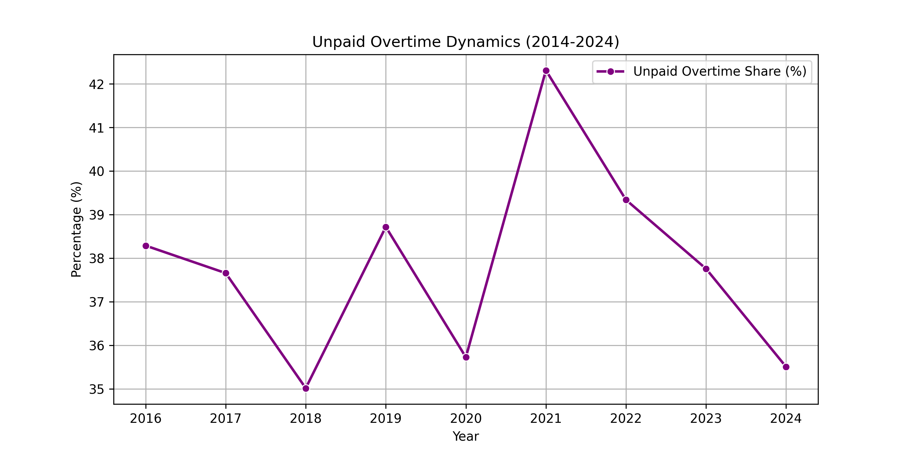

# Finnish Working Life: Myth Busting & Longitudinal Trends (2014–2024)

[](https://www.python.org/)
[](https://pandas.pydata.org/)
[](https://seaborn.pydata.org/)
[](https://opensource.org/licenses/MIT)

An end-to-end data analytics project investigating structural shifts and trends in Finnish working life over a decade (2014–2024) using historical survey microdata.

---

## 📌 Project Overview
This portfolio project processes and harmonizes multi-year survey datasets from the **Finnish Social Science Data Archive (FSD)** (Työolobarometri series). The analysis tracks how workplace dynamics, job security, physical and mental strain, workplace safety, and compensation practices evolved across Finnish enterprises over ten years.

- **Data Source:** Official annual surveys from the **Finnish Social Science Data Archive (FSD)** (*Työolobarometri* 2014–2024). *(Note: Raw microdata files are excluded from this repository in compliance with FSD data distribution terms).*
- **Timeframe:** 2014–2024.

---

## 🛠️ Tech Stack & Methodology
- **Data Processing & Cleaning:** Python (`Pandas`, `NumPy`), automated cross-year column mapping and binary recoding.
- **Data Visualization:** `Matplotlib`, `Seaborn` with custom percentage formatting and longitudinal styling.
- **Methodological Rigor:** Standardized variable harmonization across changing questionnaire structures, managing missing values (`NaN`), and converting ordinal scales into percentage shares and mean scores.

---

## 💡 Executive Summary & Key Takeaways

1. **Workplace Safety & Discrimination:**
   * **Bullying:** Harassment and psychological pressure remain the most persistent challenges, consistently affecting 35%–39% of respondents across the decade.
   * **Discrimination:** Reported discrimination experienced a sharp decline post-2020, dropping from ~27–31% down to below 10% by 2024.
   * **Physical Violence:** Incidents and threats of physical violence remained relatively low and stable (6%–11%).

2. **Work Strain & Autonomy:**
   * **Physical vs. Mental Demands:** Physical load consistently exceeds mental load scores, holding strong at 2.8–3.0 out of 4.
   * **Autonomy & Pace:** Workplace autonomy scores lead overall metrics, though work pace experienced an upward uptick after 2022.

3. **Job Security Anxieties:**
   * High structural concern remains regarding potential layoffs (*Dismissal Risk*) and forced leave (*Furlough Risk*), averaging between 3.2 and 3.5 on a 1–4 scale.

4. **Unpaid Overtime Fluctuations:**
   * Unpaid overtime engagement ranges from 35% to 42%, peaking sharply in **2021 (42.3%)** before steadily falling to **35.5% in 2024**.

---

## 📊 Visualizations

### 1. Workplace Safety and Discrimination Trends


### 2. Core Work-Life Metrics


### 3. Job Security & Employment Stability


### 4. Physical and Mental Work Load


### 5. Unpaid Overtime Dynamics


---

## 📂 Repository Structure

```text
.
├── 01_core_work_life_indices.ipynb            # Core indices and general workplace metrics
├── 02_unpaid_overtime.ipynb                    # Analysis of unpaid overtime and working hours
├── 03_job_security.ipynb                       # Employment stability and perceived job security trends
├── 04_physical_mental_load.ipynb               # Physical and mental strain indicators
├── 05_data_harmonization.ipynb                 # Master harmonization script for raw survey years
├── 06_visualization_and_analysis.ipynb         # Final trend aggregation and visualization generation
├── README.md                                   # Project documentation
│
├── harmonized_physical_mental_load_2014_2024.csv # Exported aggregated trends: Work Load
├── harmonized_safety_indicators.csv            # Exported aggregated trends: Safety & Discrimination
├── job_security_2014_2024.csv                  # Exported aggregated trends: Job Security
├── unpaid_overtime_2014_2024.csv               # Exported aggregated trends: Unpaid Overtime
├── work_life_2014_2024.csv                     # General harmonized workplace metrics
│
├── job_security_trend_2014_2024.png            # Visualization output: Job Security
├── physical_mental_load_trend_2014_2024.png    # Visualization output: Physical & Mental Load
├── simple_indices_trend_2014_2024.png          # Visualization output: Core Indices
├── unpaid_overtime_trend_2014_2024.png         # Visualization output: Unpaid Overtime
└── workplace_safety_and_discrimination_trends.png # Visualization output: Safety & Discrimination
```

---

## 👩‍💻 Author

**Oksana Kocherzhat**  
Data Analyst (OAMK)  
📍 Finland  
🔗 LinkedIn: https://www.linkedin.com/in/oksana-kocherzhat-834518231
